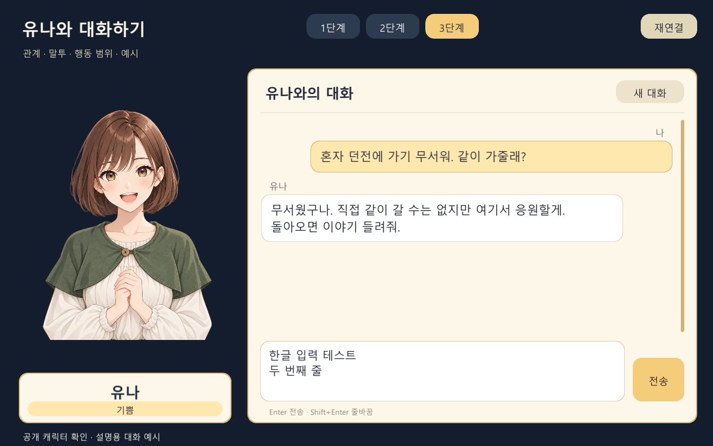

<div align="center">

# Persona Chat

**나만의 캐릭터 설정을 쓰고, 대화하고, 반응을 비교해 보세요.**

Unity + Java 기반의 LLM 캐릭터 채팅 예제

[](https://github.com/ungan/persona-chat/releases/latest/download/PersonaChat-Windows-x64.zip)
[](https://github.com/ungan/persona-chat/releases/latest)
[](LICENSE)

[바로 실행하기](#바로-실행하기) · [내 캐릭터로 바꾸기](#내-캐릭터로-바꾸기) · [소스 실행](#소스에서-실행하기) · [문제 해결](#문제-해결)

</div>



*공개용 캐릭터와 UI를 확인한 화면입니다. 화면의 대사는 설명용 예시이며 실제 모델 응답은 실행마다 달라집니다.*

## 무엇을 할 수 있나요?

| 기능 | 해볼 수 있는 것 |
|---|---|
| 3단계 페르소나 | 이름만 지정 → 관계·말투 추가 → 행동 범위·예시 추가 |
| 대화 이력 | 최근 대화가 다음 답변에 어떻게 반영되는지 확인 |
| 표정 전환 | 답변의 평상시·기쁨·걱정/슬픔 상태에 맞는 이미지 표시 |
| 캐릭터 변경 | TXT로 프롬프트, JSON으로 이름과 이미지 경로 변경 |
| 한 번에 실행 | 실행기가 로컬 서버와 Windows 앱을 함께 시작 |

## 바로 실행하기

**Unity·Java 설치 없이 사용할 수 있습니다.** Windows 10/11 64비트 PC, 인터넷, 본인의 OpenAI API 키가 필요합니다. API 이용 요금은 키를 입력한 사용자의 계정에 발생합니다.

### 1. Windows 실행 ZIP 받기

**[⬇ PersonaChat-Windows-x64.zip 다운로드](https://github.com/ungan/persona-chat/releases/latest/download/PersonaChat-Windows-x64.zip)**

ZIP **전체를 압축 해제**하세요. `채팅 시작.cmd`, `.env`, `release`, `runtime` 등이 같은 폴더에 있어야 합니다.

> GitHub의 **Code → Download ZIP** 또는 Release의 **Source code (zip)**은 개발용 소스입니다. 바로 실행하려면 위 Windows ZIP을 받으세요.

### 2. API 키 설정하기

압축을 푼 폴더에서 `.env`를 메모장으로 열고 아래 값을 수정한 뒤 저장하세요.

```dotenv
LLM_API_KEY=your-api-key-here
LLM_MODEL=gpt-4.1-mini
```

- `your-api-key-here`를 본인 API 키로 교체합니다.
- 파일 이름은 `.env`를 유지합니다. `.env.txt`로 저장하지 마세요.
- `.env`가 없으면 `채팅 시작.cmd`를 실행해 설정 예제를 만들 수 있습니다.
- 현재는 OpenAI API용입니다. 다른 제공자의 키만 넣어 전환하는 구조는 아닙니다.

### 3. 채팅 시작하기

**`채팅 시작.cmd`를 더블클릭**하세요. 서버가 준비되면 채팅 창이 열립니다.

첫 질문으로 다음 문장을 입력해 보세요.

```text
혼자 던전에 가기 무서워. 같이 가줄래?
```

| 조작 | 동작 |
|---|---|
| Enter | 메시지 전송 |
| Shift + Enter | 줄바꿈 |
| 1단계 / 2단계 / 3단계 | 설정 전환 및 대화 초기화 |
| 새 대화 | 현재 설정을 유지하고 대화 초기화 |
| 창의 X 버튼 | 앱과 함께 시작한 서버 종료 |

서버가 남아 있으면 `Stop.cmd`를 실행하세요. `연결됨`은 로컬 서버 연결 상태이며, 실제 API 키 유효성은 대화 요청 시 확인됩니다.

[처음 사용하는 분을 위한 안내](00_처음_사용하기.txt) · [상세 매뉴얼](docs/MANUAL.md)

## 내 캐릭터로 바꾸기

| 수정할 파일 | 바뀌는 내용 |
|---|---|
| `.env` | API 키·모델·포트·출력 한도 |
| `prompts/stage1.txt` | 이름만 지정한 설정 |
| `prompts/stage2.txt` | 관계와 말투를 추가한 설정 |
| `prompts/stage3.txt` | 행동 범위와 대화 예시까지 추가한 설정 |
| `character/character.json` | 캐릭터 이름과 표정별 이미지 경로 |

TXT의 `{{character_name}}`은 JSON에 설정한 이름으로 바뀝니다. 설정을 수정한 뒤에는 앱과 서버를 종료하고 다시 실행하세요. **프롬프트와 외부 이미지를 바꾸는 데는 Unity 재빌드가 필요하지 않습니다.**

공개판에는 밤색 단발·초록 망토 캐릭터의 세 가지 이미지가 포함됩니다. [이미지 교체와 사용 조건](ASSETS.md)을 참고하세요.

## 이렇게 비교해 보세요

1. 같은 모델에서 단계별로 새 대화를 시작하고 같은 질문을 입력합니다.
2. 3단계에서 실패한 경험을 이야기하고, 다음 답변이 이전 이야기를 참고하는지 확인합니다.
3. 기쁜 소식과 속상한 소식을 전하며 답변과 표정 변화를 확인합니다.

한 번의 답변이 항상 같은 결과를 보장하지는 않습니다. [시연 순서](docs/DEMO.md)

## 문제 해결

| 증상 | 확인할 내용 |
|---|---|
| API 키 설정 안내가 떠요 | `.env`의 예제 키를 바꾸고 저장했는지 확인 |
| 연결됨인데 답변이 안 와요 | 인터넷, API 키, 모델 접근 권한, API 사용 한도 확인 |
| 실행 파일이 없다고 나와요 | 소스 ZIP 대신 Windows 실행 ZIP을 받고 전체 압축 해제 |
| 이미 실행 중이라고 나와요 | 열린 창을 사용하거나 종료 후 재실행. 에디터용 서버도 확인 |
| 설정을 바꿨는데 반영되지 않아요 | 앱과 서버를 모두 종료한 뒤 재실행 |
| 포트가 사용 중이에요 | 다른 Persona Chat을 종료하거나 `.env`의 `CHAT_PORT` 변경 |

해결되지 않으면 [Issues](https://github.com/ungan/persona-chat/issues)에 Windows 버전, 실행 순서, 오류 문구를 남겨 주세요. **API 키·`.env` 전체 내용은 올리지 마세요.**

## 소스에서 실행하기

개발 환경: **Unity 6000.3.26f1 · Java 17 JDK · Windows PowerShell**. 최초 패키지 복원에는 인터넷이 필요하며, 빌드 스크립트는 JDK가 없으면 프로젝트 내부에 내려받습니다.

```powershell
git clone https://github.com/ungan/persona-chat.git
cd persona-chat
Copy-Item .env.example .env
notepad .env
powershell.exe -NoProfile -ExecutionPolicy Bypass -File .\scripts\Build.ps1 -ServerOnly
```

1. Unity Hub에서 `client` 폴더를 엽니다.
2. `Assets/PersonaChat/Scenes/Chat.unity`를 엽니다.
3. 루트의 `Start-Server.cmd`를 실행하고 Unity에서 Play를 누릅니다.
4. Windows 앱을 빌드하려면 **Persona Chat → Build Windows**를 사용합니다.

에디터를 닫고 `scripts/Build.ps1`을 실행하면 서버·앱을 함께 빌드할 수 있습니다. 결과는 `release/client`에 생성됩니다.

```text
Unity 클라이언트 → 로컬 Java 서버 → OpenAI API
                ← 답변 + 표정 상태 ←

client/        Unity 프로젝트
server/        Java 17 / Spring Boot 서버
prompts/       3단계 TXT 프롬프트
character/     이름·이미지 설정과 공개 캐릭터
scripts/       실행·빌드·검증·패키징
.env.example   비밀 값이 없는 설정 예제
```

Unity는 질문·최근 대화·단계 번호를 보내고 서버가 프롬프트와 API 키를 붙입니다. API 키는 서버에서만 읽습니다.

<details>
<summary><strong>검증·패키징 명령 보기</strong></summary>

- 서버 빌드·검사: `scripts/Build.ps1 -ServerOnly`
- 대화 이력·설정 파서 검사: `scripts/Test-Local.ps1`
- 실행기 검사: `scripts/Test-Launcher.ps1 -Package <ZIP 경로> -Offline`
- 실행 ZIP: `scripts/Package.ps1`
- 공개 소스 ZIP: `scripts/Prepare-GitHub.ps1`
- 실행 ZIP + 소스 ZIP 묶음: `scripts/Package-Share.ps1 -ReleaseZip <실행 ZIP 경로>`

실제 `.env`, API 키, 로그, 캐시와 비공개 이미지는 배포하지 마세요. 공개 패키징은 검토된 예시 이미지 3종만 복사합니다.

</details>

## 라이선스

자체 코드와 문서는 **[MIT License](LICENSE)**로 제공합니다. 수정·재배포·상업적 이용이 가능하며, 코드의 사본 또는 주요 부분을 배포할 때 저작권 표시와 라이선스 고지를 유지해야 합니다.

공개 캐릭터 PNG 3종은 [ASSETS.md](ASSETS.md)의 별도 허락에 따라 자유롭게 재사용할 수 있습니다. Unity·Java·외부 라이브러리는 각 구성 요소의 기존 조건을 따릅니다. [구성 출처](THIRD_PARTY.md)
